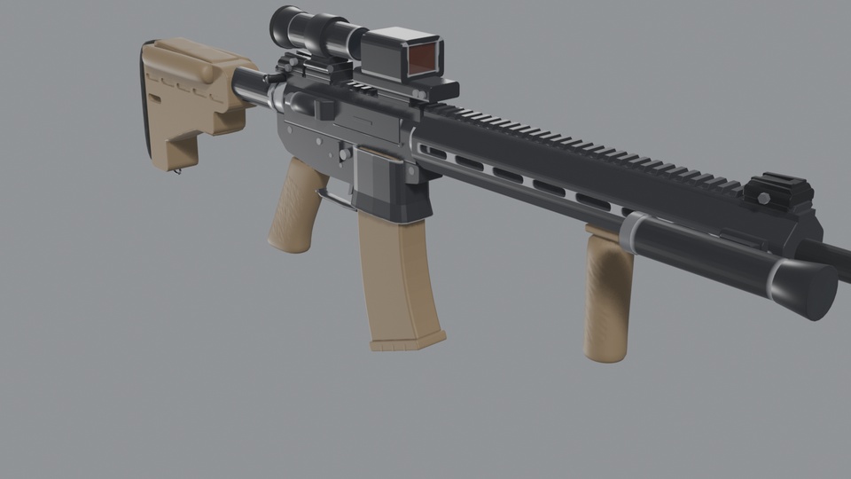
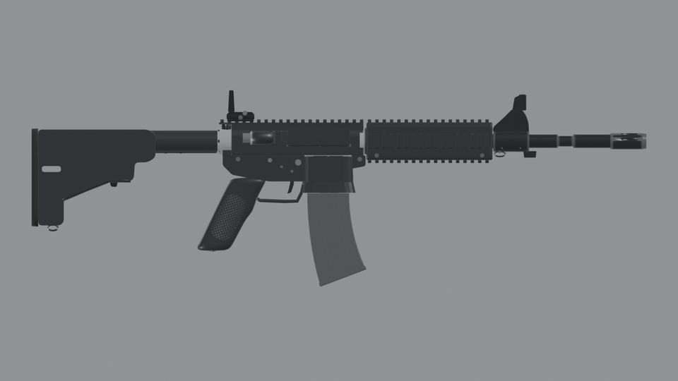
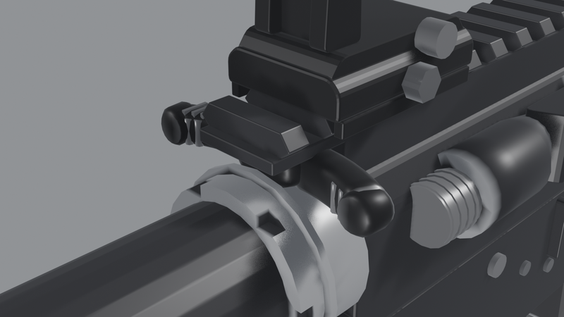
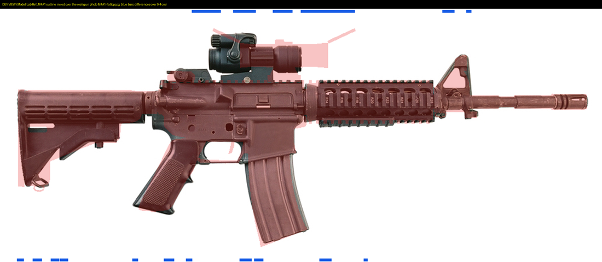
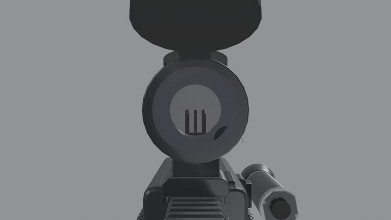
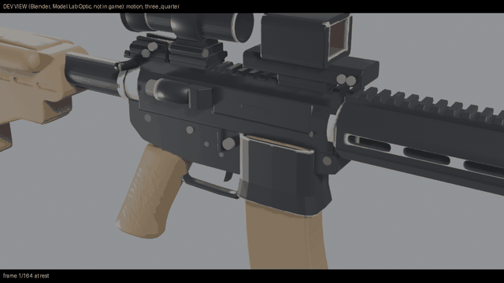
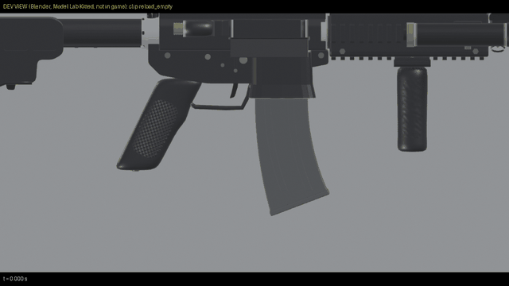

# Model Lab

<!-- mcp-name: io.github.hpdkhoa/modellab-mcp -->

An MCP server that draws game gun models in Blender from a few parameters. Each build has real parts at real
proportions, one bone a moving part, its clips, and the facts a game needs. Every build checks itself, and a second
check measures its outline against a photo of the real gun.



Ask for "an M4A1 with a red dot and a light on the right rail" and Model Lab writes a rigged FBX, an FBX for each
attachment, a `.blend`, a sheet of pictures and a `facts.json` with every mark in gun space. It tells you which checks
failed, if any. It makes **game models only**: outside shapes and moving parts. It draws no working internals and
writes no fabrication data.

## What a build gives you

| You get | What it is |
|---|---|
| `SK_<name>_Rig.fbx` | the gun on its rig: Bolt, ChargingHandle, DustCover, BoltCatch, MagRelease, Selector, Trigger, ForwardAssist, Magazine, MagRound, Stock, each with its real pivot and travel |
| `SM_<name>_Magazine.fbx` | the magazine alone, its origin on the feed lips, for the hand |
| one FBX an attachment | its origin on its recoil lug; `SK_` when it has moving parts (folding sights, flip caps, a flip magnifier) |
| `<name>.blend` | everything, with the moving parts' cycle as an action |
| `facts.json` | the marks (chamber, port, magazine well, feed lips, grip, support hand, muzzle, sights), the rails and their slots, the attachments and their sockets, the parts table, every check |
| `sheet.png` | labelled views: both sides, the top, the front, close views, the open action, the sight picture |

Gun space: centimetres, +X the gun's left, +Y forward, +Z up. The origin is the bolt face at rest on the bore.



## Install

Model Lab needs Python 3.10 or later and [Blender](https://www.blender.org/download/) 4.2 or later.

    uvx modellab-mcp

or

    pip install modellab-mcp

Add it to your MCP client (Claude Code, Claude Desktop, or any client that runs stdio servers):

```json
{
  "mcpServers": {
    "modellab": {
      "command": "uvx",
      "args": ["modellab-mcp"],
      "env": { "MODELLAB_BLENDER": "C:/Program Files/Blender Foundation/Blender 4.2/blender.exe" }
    }
  }
}
```

| Setting | What it does |
|---|---|
| `MODELLAB_BLENDER` | Blender's executable. Leave it out when Blender is on the PATH or in its usual install folder. |
| `MODELLAB_OUT` | The only folder Model Lab writes to. Defaults to `~/.modellab`. |
| `MODELLAB_WAIT_FOR` | Optional process names that hold the machine, such as `UnrealEditor.exe,blender.exe`. A build refuses to start while one runs. Off by default. |
| `MODELLAB_IDLE_OK` | With `MODELLAB_WAIT_FOR`: parts of a command line that mark a long-lived worker (default `poselab_mcp`). Such a worker counts only while it is busy. |

## The tools

| Tool | What it does |
|---|---|
| `list_presets` | The ready guns: M4A1, M16A2, AR15, M4A1_Kitted, AR15_Optic. |
| `list_platforms`, `describe_params` | The gun families and every parameter: its range or choices, its unit, its meaning, and the sources of the real numbers. |
| `list_attachments` | Nine attachment classes for the rails and M-LOK slots. |
| `build_gun` | Builds a gun from a preset or a platform, with any parameter changed. `motion=true` adds GIFs of the cycle. |
| `build_gun_clips` | The gun's own clips on a build's rig, measured, one FBX and one GIF each. |
| `list_references`, `compare_to_reference` | The real-gun check: a build's outline against a photo. |
| `list_builds`, `read_build` | The builds so far and their facts. |

The same calls run from a shell: `modellab presets`, `modellab build M4A1 stock_pos=2 name=MyM4`,
`modellab clips <build>`, `modellab compare`. Run `modellab help` for the list.

## Every build checks itself

A build reports each check with its value. The checks:

- the length against the published figure (the M4A1 at 29.75 and 33 in, the M16A2 at 39.63 in);
- the chamber on the bore;
- the dust cover: closed over the whole port, hinged on its bottom edge, and open against the lower, not through it
  (the build swings it a degree at a time and stops it where it first touches);
- the magazine clear of its well's walls and seated;
- the bolt's travel past the top round;
- the sight line: the rear aperture and the front post at one height;
- each attachment on a rail it fits, clear of the gun in every state, and its optic on the iron sight line;
- **every visible part with its real features** (`parts_complete`). The parts table lists each part a person sees
  on the real gun and the features that make it read as that part: the charging handle's swept wings, finger hooks,
  latch and roll pin; the bolt catch's serrations; the castle nut's notches; the front sight base's bayonet lug,
  swivel and taper pins; and so on. A missing feature fails the build. Marks such as rail numbers are listed as
  texture, not shape.



## The real-gun check

`compare_to_reference` draws the build's side outline at a reference photo's own scale. It lines the build up on the
muzzle and the bore, measures both outlines column by column, and names the parts where they differ. The overlay
shows the model in see-through red over the photo: dark photo showing through is real gun the model misses.



This check found the faults the self-checks could not: the lower 1.55 cm too far back, the front sight base 2.4 cm
back and the wrong shape, the stock's outline, the magazine's curve, and the rail's height. Now no stretch of the
gun's outline over 1.75 cm long is more than 1 cm off. Attachments are classes, not the photo's exact models, so the
check keeps their outline apart.

The reference ships with the package: a photo of an M4A1 carbine from PEO Soldier,
[File:M4A1-flattop.jpg](https://commons.wikimedia.org/wiki/File:M4A1-flattop.jpg) on Wikimedia Commons, in the public
domain as a work of the US Federal Government. The check reads its scale from the rail's teeth, 0.394 in apart.

## Attachments on sockets

Each rail reports its slots at the Picatinny pitch (MIL-STD-1913), slot 0 at the rear. M-LOK handguards report their
slots too (32 by 7 mm, 40 mm apart). Pass attachments by name, or as `{item, rail, slot, state, options}`:

    {"preset": "M4A1", "params": {"attachments": [{"item": "flip_rear", "state": "down"}, "red_dot", "weapon_light"]}}

The nine classes: folding rear and front sights, the M4's carry handle, a 30 mm red dot with flip caps, a holographic
sight, a 3x magnifier on a flip mount, a 4x32 prism sight, a vertical grip, a weapon light. A build checks that each
fits its rail, clears the gun in every state, and clears the others as shown. When one blocks another's move, the
build lists it: behind a magnifier, the rear sight goes up only after the magnifier swings aside.



## Motion and clips

Every `.blend` holds the cycle as an action. `motion=true` renders it as GIFs: the charging handle drawn back, the
cover springing open, the carrier flying home, the magazine out and in, then the attachments' own moves.



`build_gun_clips` keys the gun's clips at 60 frames a second from real timings: charge, chamber check, fire (a 75 ms
cycle), the last shot (the bolt held on its catch), reload, empty reload, and the stock's positions. Each clip is
measured: every part on its own axis, the full stroke, the cover open before the carrier has moved 1 cm, the magazine
out of the well and seated, the bolt held until the magazine is in.



## Limits

- One platform so far: the AR-15 family. Others will follow.
- One reference photo: the M4A1 from its right side.
- The clips are the gun's side only. A hand's clips need an arms rig.
- No selector clip yet: the lever's direction at SAFE is not yet checked against a source.
- Many numbers are estimates sized from photographs. `describe_params` lists every source and every estimate.

## Trademarks

M-LOK is a trademark of Magpul Industries. Model Lab draws M-LOK slots to their published dimensions and is not
connected with Magpul. AR-15 is a trademark of Colt's Manufacturing; here it names the rifle family in its common
sense. Military designations (M4A1, M16A2, M68) name the guns and parts Model Lab copies. No product is endorsed.

## License

MIT. See [LICENSE](LICENSE).
